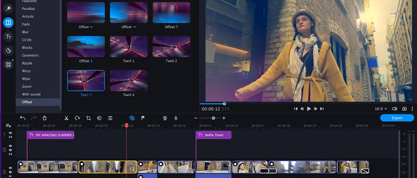
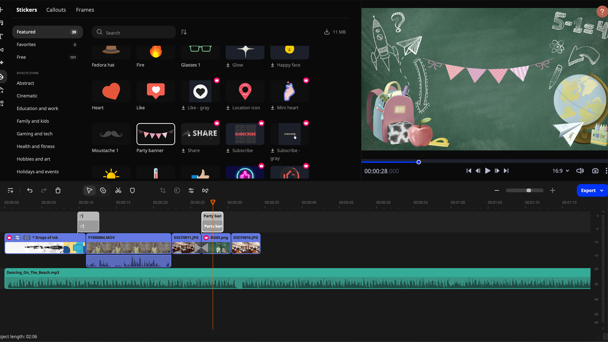

# Movavi Video Suite for Editing and Media Production

Movavi Video Suite combines video editing, media conversion, and screen recording.
Its tools support projects such as tutorials, demonstrations, social clips, and family videos.

This independent Editor Movavi Suite guide focuses on planning a project and reviewing its output.
Movavi Video Suite features and bundled components should be checked against the installed version.

[](https://editor-movavi-suite.github.io/Movavi-Video-Suite/)

The supplied source snapshot belongs to Shotcut, a separate open-source video editor.
Linked files provide comparative references for filters, tests, and maintenance tooling.
They are not Movavi source code, Movavi presets, or components of the Movavi installer.

## Features

When researching movavi video suite 2026, distinguish the bundle from an individual editor license.
Confirm the included applications and available features before planning a workflow around them.

| Production task | Working approach | Review before delivery |
| --- | --- | --- |
| Timeline editing | Arrange clips around the intended sequence | Check cut points, gaps, and the final duration |
| Screen recording | Choose the relevant capture area and audio sources | Make a short test and check readability and sound |
| Media conversion | Match the destination's format requirements | Reopen the output and confirm its streams |
| Vertical video | Frame the subject for the target aspect ratio | Check movement and titles across the whole clip |
| Spoken presentation | Keep narration clear and background audio controlled | Listen for clipping, abrupt changes, and reduced intelligibility |
| Captioned video | Review wording and timing | Check names, line breaks, and overlap with other graphics |

The [official suite overview](https://www.movavi.com/suite/) describes the product's scope.
Availability of individual tools can depend on the version, platform, and purchase.

For a movavi video suite video editor workflow, establish the sequence before polishing effects.
Keep original recordings and source media available alongside the editable project.

- Choose the intended frame size and delivery context.
- Keep titles readable at the expected viewing size.
- Use transitions when they clarify a change in time or subject.
- Review the beginning and end for accidental empty frames.



When using movavi video suite ai tools, review the result in motion.
A successful preview frame does not show how a mask or noise-removal effect behaves throughout a clip.

The supplied Shotcut filter definitions provide separate examples of effect composition:

- [Text Simple with Gradient Back](filter-sets/Text%20Simple%20with%20Gradient%20Back)
- [Soft Focus](filter-sets/Soft%20Focus)
- [Obscure With Mosaic](filter-sets/Obscure%20With%20Mosaic)
- [Obscure With Blur](filter-sets/Obscure%20With%20Blur)
- [Glow Intensity](filter-sets/Glow%20Intensity)

These are Shotcut filter sets stored as MLT XML.
They should not be described as importable Movavi effects or templates.

## Tutorial

A focused editing exercise should test a complete path from source media to reviewed export.
Use a short sequence with a visible action, a spoken sentence, and a title.

1. Identify the main point the sequence needs to communicate.
2. Remove material that does not support that point.
3. Check continuity at each cut.
4. Balance narration and supporting audio.
5. Review titles and captions at normal playback speed.
6. Export a short sample before processing the full project.

For a screen-recorded lesson, inspect small text in the actual delivery file.
An editor preview can hide readability problems caused by downscaling or compression.

Keep narration synchronized with the action it describes.
Leave enough time for a viewer to understand a menu choice or on-screen result.

The supplied Shotcut tests illustrate two related quality checks:

- [test_subtitles.cpp](tests/test_subtitles.cpp) covers subtitle-related behavior.
- [test_mix_transition_order.cpp](tests/test_mix_transition_order.cpp) covers transition ordering.

Those tests target Shotcut internals.
They do not validate a Movavi project or establish identical timeline behavior.

## Documentation

Record the delivery specification together with the project.
Include the required dimensions, frame rate, audio expectations, and destination format.

The following PowerShell example uses ffprobe, a separate tool from the FFmpeg project.
It reads metadata from an existing video export and prints the result as JSON.

```powershell
$inspectionTool = "ffprobe"
$exportedVideo = "delivery.mp4"
& $inspectionTool -v error -show_format -show_streams -of json $exportedVideo
```

The example assumes ffprobe is already available in the command environment.
It does not launch Movavi, alter the export, or create a new media file.

Use the output to compare the actual file with the delivery specification.
Check the video dimensions, stream types, duration, and reported audio properties.

The [ffprobe documentation](https://ffmpeg.org/ffprobe.html) explains the inspection options.
Metadata inspection should be followed by watching and listening to the exported file.

The supplied Shotcut references include:

- [ffmpeg-codecs.sh](scripts/ffmpeg-codecs.sh), which processes FFmpeg codec information.
- [test_exportpresetdialog.cpp](tests/test_exportpresetdialog.cpp), which tests export-preset handling.

These files describe Shotcut maintenance and testing.
Their options and preset behavior are not Movavi configuration instructions.

## Report a bug

A useful report identifies whether the problem occurs during import, playback, editing, recording, or export.
Choose a small example that reproduces the affected stage.

Include these details where relevant:

- Movavi application name and version.
- Operating system and graphics hardware.
- Source file format, dimensions, and frame rate.
- The operation that triggers the problem.
- Whether the issue appears in the preview, the export, or both.
- The exact error message and the selected export settings.

If a narration source is an existing uncompressed PCM WAV file, Python can inspect its basic properties.
The following example uses the standard wave module and reads the file without modifying it.

```python
import wave
with wave.open("narration.wav", "rb") as audio:
    rate = audio.getframerate()
    print("Channels:", audio.getnchannels())
    print("Sample rate:", rate)
    print("Duration:", audio.getnframes() / rate)
```

The example assumes Python is available and the WAV file uses a supported format.
It does not measure loudness, detect clipping, or evaluate intelligibility.

The [Python wave documentation](https://docs.python.org/3/library/wave.html) describes the properties used here.
For a sound problem, include a description of what is audible as well as technical metadata.

The supplied Shotcut snapshot contains additional implementation references:

- [test_gpuinfo.cpp](tests/test_gpuinfo.cpp) tests graphics-related selection logic.
- [test_dataqueue.cpp](tests/test_dataqueue.cpp) tests data queue behavior.
- [test_addonqmlgenerator.cpp](tests/test_addonqmlgenerator.cpp) tests add-on QML generation.
- [minimalmediaplugin.json](MinimalMediaBackend/minimalmediaplugin.json) declares a minimal media backend key.

Those files do not reveal how Movavi implements rendering or hardware acceleration.



## Translations

For captioned projects, separate spoken-language transcription from interface translation.
Names, technical terms, and punctuation still need review after automatic processing.

- Check spelling against the source material.
- Keep line lengths readable.
- Confirm that captions enter and leave at appropriate moments.
- Review text placement against important visual content.

The supplied [update-tx.sh](scripts/update-tx.sh) updates Shotcut translation resources.
It is not a Movavi subtitle editor or a translation configuration for Movavi.

## Developers

Documentation changes should explain a specific production decision or correct a verified detail.
Name the application associated with every command, source reference, and screenshot.

The supplied Shotcut maintenance references include:

- [optimize-png.sh](scripts/optimize-png.sh), which optimizes project image assets.
- [shotcut.css](docs/shotcut.css), which styles its generated documentation.

These resources concern Shotcut development rather than Movavi customization.
Use the [Movavi support center](https://help.movavi.com/) for product-specific instructions.

Preserve the editable project and the source media when handing work to another editor.
Include a reviewed export so that the intended result can be compared with later revisions.

## Related Search Terms

Editor Movavi Suite, Movavi Video Suite, movavi video suite 2026, movavi video suite video editor, movavi video suite ai tools, video, video-editing, video-editor, video-production, screen-capture, video-recording, video-transcoding, multimedia, audio, subtitles
